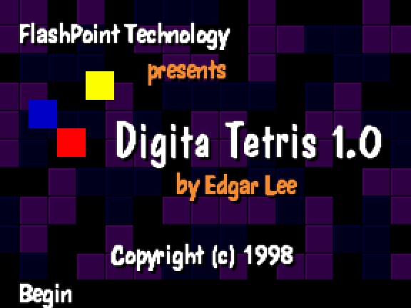
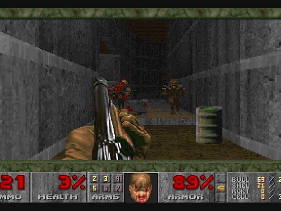

# Kodak DC260 (Digita OS) in MAME

A MAME driver for the Kodak DC260 digital camera (1998), which runs
FlashPoint's Digita operating environment on VxWorks 5.3. It runs the camera
firmware 1.0.2 with its menus, and Digita applications from the CompactFlash
card, among them Digita Tetris and DoomD, the Digita port of Doom.

| Tetris (`tests/tetris-90s.png`) | DoomD demo (`tests/doom-90s.png`) |
|---|---|
|  |  |

MAME had no MPC8xx PowerPC, so this adds one.

## What is here

- `patches/`: against MAME commit `60e07cb1`.
  - PowerPC core: MPC823 (`PPCCAP_8XX`): no FPU (unimplemented opcodes go to
    0x1000), software TLB (0x1100 to 0x1400 exceptions), the 8xx SPRs,
    EIE/EID/NRI.
  - PowerPC core fix: `m_tb_divisor * clock()` overflowed 32 bits, so the
    decrementer ran about 100 times too fast with a large divisor.
  - PowerPC core fix: a 32-bit bus picks the 32-bit cache by data width, not
    only on the 4xx.
  - `src/mame/kodak/mpc823_imm.*`: the internal memory map: SIU, PIT, RTC,
    CPM interrupt controller, SMC1 UART, SPI and I2C.
  - `src/mame/kodak/dc260.cpp`: the camera, including the microcontroller
    (buttons, mode dial, power, status LCD) that talks to the CPU over SPI,
    the 823 video controller (YCbCr 4:2:2, 576x432), the 24C16 EEPROM and
    the CompactFlash card on the PCMCIA controller.
  - UI: `skip_warnings` in `ui.ini` is honoured.
- `tools/build-mame.sh`: fetches MAME at that commit, applies the patch and
  builds the `digita` subtarget.
- `tools/build-media.sh`: the firmware and three CompactFlash cards from
  `Digita OS.zip`.
- `cards/base_dc260.hd.xz`: an empty 32 MB card as the emulated camera
  formats it (MBR, then a FAT the firmware labels VXDOS4.0 at sector 32). A
  card made with `mkfs.fat` gets "Card requires Formatting". Free space is
  zeroed.
- `tools/test-boot.sh`: boots the Tetris and Doom cards without a window and
  compares the screen with `tests/`. Emulation is deterministic, so they
  must match pixel for pixel.

## What you need (not included)

`Digita OS.zip`, a collection of DC260 firmware and Digita applications. The
scripts take from it `firmware-1.0.2.zip` (`system/schigh.bin`,
`system/flshrsrc.bin`), `tetris.zip`, `doomd.cam` and the shareware
`DOOM1.WAD`.

Linux packages (Debian/Ubuntu names): `git make g++ python3 python3-pil
libsdl2-dev libsdl2-ttf-dev libfontconfig-dev libpulse-dev libasound2-dev
qtbase5-dev unzip xz-utils mtools`. `mold` is optional and makes linking much
faster.

## Build and run

```sh
tools/build-mame.sh                      # 30 to 60 minutes; build/mame/digita
tools/build-media.sh "Digita OS.zip"
tools/test-boot.sh                       # optional, under a minute, no window
cp build/cards/card-tetris.hd tetris.hd
build/mame/digita dc260 -rompath build/roms -window -nomaximize -hard tetris.hd
```

| Card | What it does |
|---|---|
| `card.hd` | Tetris in `/SYSTEM`; the camera starts normally (Menu, right to Applications, Start) |
| `card-tetris.hd` | the same plus `/SYSTEM/TETRIS.CXM`: starts straight into Tetris |
| `card-doom.hd` | DoomD and `DOOM1.WAD`: starts straight into Doom |

The `.CXM` file next to an application makes the camera start it at power
on; it is what Applications > Start writes before power cycling. The card
image is written to, so start from a fresh copy to get it as built.

## Keys

| Key | Camera | In Doom |
|---|---|---|
| Arrows | four-way control | |
| M | Menu | Doom's menu |
| 1, 2, 3 | soft keys left, middle, right | middle: run; right: map |
| Left Ctrl | switch 0.4 | fire |
| Space | switch 0.5 | use |
| Enter | switch 1.7 | Enter in menus, "y" |
| - and = | switches 1.5, 1.6 | smaller and larger view |
| O | Power | |

The mode dial (Capture, Review, Connect, Brag Book) is in MAME's
Machine Configuration menu. Switch 2.4 turns the LCD off (Display).

## Known limits

- MAMED and MESSD stop at a missing `sysSymTbl` in firmware 1.0.2. Other
  applications in the zip (Calc, Sokoban, Bombsweep, Boulders) were not
  tried properly.
- No CCD: capturing a picture does not work. No sound.
- `DIGITA_ECHO=<file>` copies the VxWorks console (SMC1) to a file.

## License

BSD 3-Clause, like MAME; see `LICENSE`.
